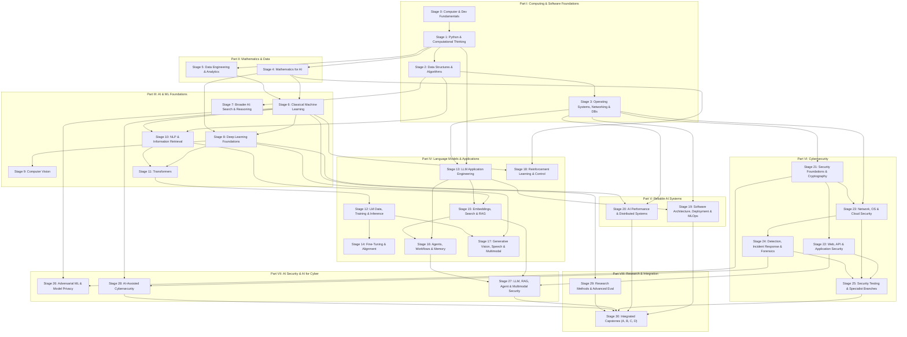

# Master Curriculum Inventory: AI, Systems & Cybersecurity Academy

> **Source Document:** `AI-Systems-and-Cybersecurity-Master-Roadmap.pdf` (November 2026)  
> **Structure:** 8 Parts | 31 Stages (Stages 0 through 30) | 4 Capstones | 25+ Scratch Implementations  
> **Language Standard:** 100% English only across all titles, lessons, diagrams, labels, and code.  
> **Preservation Rule:** Every single original topic, scratch build, project, and mastery check from the source PDF is preserved verbatim, accompanied by clearly delineated supporting and expanded subtopics.

---

## Master Architecture & Dependency Flow

---

## PART I — COMPUTING AND SOFTWARE FOUNDATIONS

### Stage 0 — Computer and Development Fundamentals
- **Prerequisites:** None (Absolute Beginner entry point).
- **Original Roadmap Topics (Verbatim):**
  - Binary, hexadecimal, text encoding, Unicode
  - CPU, RAM, storage, GPUs, and the memory hierarchy
  - Programs, processes, threads, files, and permissions
  - Operating systems and virtual machines
  - Terminal navigation, environment variables, package installation
  - Git commits, branches, merges, and conflict resolution
  - Basic internet architecture
- **Expanded Supporting Subtopics:**
  - Logic gates (AND, OR, NOT, XOR, NAND) and boolean arithmetic
  - Two's complement representation, integer overflow, floating-point IEEE-754 preview
  - Deep CPU Architecture: ALU, Control Unit, Registers, Instruction Cycle (Fetch, Decode, Execute, Memory, Writeback), Clock cycles, RISC vs. CISC
  - Linux filesystem hierarchy (`/`, `/etc`, `/dev`, `/proc`, `/sys`), file descriptors, POSIX permissions (`rwx`, `chmod`, `chown`)
  - Git internals: blobs, trees, commits, references, `.git` folder anatomy
  - Networking basics: IP addresses, subnetting, ports, TCP 3-way handshake overview
- **Build From Scratch (Verbatim):**
  - A command-line file organizer
  - A file metadata inspector
  - A directory-processing script that produces a report
- **Project (Verbatim):**
  - A reproducible development workspace with installation instructions and a version-controlled project.
- **Mastery Check (Verbatim):**
  - Start from a clean environment, install dependencies, run the application, diagnose a failure, and restore a previous working version.
- **Planned Visuals & Simulators:**
  - Interactive Binary/Hexadecimal Converter & Bitwise Visualizer
  - Memory Hierarchy Interactive Pyramid (L1, L2, L3, RAM, SSD, Network with latency scale)
  - 5-Stage CPU Instruction Execution Simulator (Pilot Lesson flagship)
  - Visual Git Commit Graph and Branch Tree

---

### Stage 1 — Python and Computational Thinking
- **Prerequisites:** Stage 0.
- **Original Roadmap Topics (Verbatim):**
  - Types, variables, control flow, functions
  - Lists, dictionaries, sets, tuples, iterators
  - Mutability, references, scope, exceptions
  - Modules, packages, environments, dependencies
  - Classes and composition
  - Type hints, logging, testing, profiling, debugging
  - Files, CSV, JSON, regular expressions, HTTP requests
  - Async programming and concurrency fundamentals
- **Expanded Supporting Subtopics:**
  - Python memory model: reference counting, garbage collection, `id()`, shallow vs. deep copies
  - Python bytecode and execution under CPython VM
  - Decorators, generators, and context managers (`__enter__`, `__exit__`)
  - Static typing with `mypy` and runtime validation with Pydantic
  - Unit testing with `pytest`, assertions, fixtures, and coverage metrics
  - Concurrency paradigms: Threading vs. Multiprocessing vs. `asyncio` event loop (GIL constraints)
- **Build From Scratch (Verbatim):**
  - A CSV parser for a deliberately limited format
  - A command-line task manager
  - A log parser and summary generator
  - A simple socket-based HTTP client after networking basics
- **Project (Verbatim):**
  - A tested data-processing application with useful error messages and a command-line interface.
- **Mastery Check (Verbatim):**
  - Handle malformed files, missing values, failed requests, and unexpected inputs without silently producing incorrect results.
- **Planned Visuals & Simulators:**
  - Python Memory & Reference Inspector (Heap vs. Stack, mutable mutations)
  - Async Event Loop step-by-step visualizer (Microtasks, Call Stack, Callback Queue)
  - Regular Expression Finite State Machine Visualizer

---

### Stage 2 — Data Structures, Algorithms, and Broader Programming
- **Prerequisites:** Stage 0, Stage 1.
- **Original Roadmap Topics (Verbatim):**
  - Time and memory complexity, Big-O
  - Arrays, linked lists, stacks, queues, hash tables
  - Trees, heaps, graphs, tries
  - Searching, sorting, recursion, divide-and-conquer
  - Greedy algorithms, dynamic programming
  - Breadth-first and depth-first search, shortest paths
  - Floating-point representation and numerical errors
  - Learn enough C for pointers, allocation, stack/heap, compilation, and memory errors
  - Add basic HTML, CSS, and JavaScript for usable interfaces
- **Expanded Supporting Subtopics:**
  - Amortized analysis and master theorem for recurrences
  - Collision resolution in hash tables: separate chaining vs. open addressing (linear/quadratic probing, robin hood hashing)
  - Priority queues and binary heap array representations
  - Graph representations: adjacency list vs. adjacency matrix vs. edge list
  - Dijkstra’s algorithm, Bellman-Ford, and topological sort
  - C memory management: `malloc`, `calloc`, `realloc`, `free`, pointer arithmetic, segmentation faults, Valgrind memory leak detection
- **Build From Scratch (Verbatim):**
  - A hash table
  - A binary heap
  - A graph traversal toolkit
  - A small inverted search index
  - An LRU cache
- **Project (Verbatim):**
  - A small searchable collection with an interface and measured algorithm choices.
- **Mastery Check (Verbatim):**
  - Choose appropriate structures, justify their complexity, and explain why a numerically or algorithmically naive implementation fails.
- **Planned Visuals & Simulators:**
  - Big-O Complexity Graph Visualizer (Logarithmic, Linear, Polynomial, Exponential)
  - Interactive Hash Table with Hash Function collision explorer
  - Interactive Graph Pathfinding (BFS, DFS, Dijkstra step-by-step grid)
  - Interactive LRU Cache eviction queue visualizer
  - C Pointer & Stack/Heap Memory Layout Explorer

---

### Stage 3 — Operating Systems, Networking, and Databases
- **Prerequisites:** Stage 0, Stage 1, Stage 2.
- **Original Roadmap Topics (Verbatim):**
  - Scheduling, synchronization, locks, races, deadlocks
  - Virtual memory, file systems
  - TCP/IP, UDP, DNS, HTTP, TLS, sockets
  - Request lifecycles, proxies, timeouts, retries
  - Relational modeling, SQL, joins, indexes, transactions
  - Isolation, consistency, backups, recovery
  - Caches, queues, object storage
  - Containers and isolation boundaries
- **Expanded Supporting Subtopics:**
  - Process states (Ready, Running, Blocked), context switching overhead, CPU scheduling algorithms (Round Robin, CFS)
  - Concurrency primitives: Mutexes, semaphores, condition variables, reader-writer locks, deadlock four conditions
  - Virtual memory: Paging, page tables, TLB, page faults, swapping
  - OSI 7-layer vs. TCP/IP 4-layer model; TCP windowing, congestion control (Slow Start, Congestion Avoidance)
  - TLS 1.3 handshake: Key exchange, certificate verification, symmetric session encryption
  - B-Trees and LSM Trees in database storage engines; SQL query planning and `EXPLAIN ANALYZE`
  - ACID properties, isolation levels (Read Uncommitted, Read Committed, Repeatable Read, Serializable), write-ahead logging (WAL)
  - Linux Namespaces (PID, Mount, Net) and Cgroups foundational to Docker containers
- **Build From Scratch (Verbatim):**
  - A local client/server program
  - A small HTTP server
  - A persistent key-value store
  - A queue with retries
  - A database-backed API
- **Project (Verbatim):**
  - A small web service with database persistence, authentication, logs, tests, and backup restoration.
- **Mastery Check (Verbatim):**
  - Trace a request from client to database, diagnose a slow query, reproduce a race condition, and restore data from backup.
- **Planned Visuals & Simulators:**
  - OS Process Scheduling & State Transition Simulator
  - Deadlock Dining Philosophers / Lock contention visualizer
  - TCP 3-Way Handshake & Packet Loss / Timeout simulator
  - B-Tree Index Search & Insertion Visualizer
  - Container Isolation (Namespace + Cgroup boundary) Diagram

---

## PART II — MATHEMATICS AND DATA

### Stage 4 — Mathematics for AI
- **Prerequisites:** Stage 1, Stage 2.
- **Original Roadmap Topics (Verbatim):**
  - Linear algebra: vectors, matrices, products, norms, projections, rank, eigenvalues/eigenvectors, SVD, positive semidefinite matrices, PCA
  - Calculus and optimization: derivatives, gradients, chain rule, Jacobians, Hessians, constraints, conditioning, convexity, numerical optimization
  - Probability: conditional probability, Bayes, independence, distributions, expectation, variance, covariance, likelihood, entropy, KL divergence
  - Statistics: sampling, estimation, uncertainty intervals, hypothesis tests, effect sizes, bootstrap, experiment design, confounding, multiple comparisons
  - Discrete math: logic, sets, combinatorics, graphs, recurrences
- **Expanded Supporting Subtopics:**
  - Matrix operations: Dot product, outer product, Hadamard product, determinant, trace, matrix inversion limits
  - Geometric transformations: Rotation, scaling, orthogonal matrices, projection matrices
  - Multivariable optimization: Gradient vectors, directional derivatives, contour plots, saddle points, condition number
  - Probability distributions: Bernoulli, Binomial, Normal/Gaussian, Uniform, Poisson, exponential family
  - Information theory: Shannon entropy, cross-entropy, mutual information, Kullback-Leibler divergence
  - Frequentist vs. Bayesian inference; Central Limit Theorem; p-values vs. confidence intervals
- **Build From Scratch (Verbatim):**
  - Small vector/matrix operations
  - Gradient descent
  - Numerical gradient checking
  - Linear regression
  - PCA using a numerical SVD routine
  - Bootstrap uncertainty estimation
- **Project (Verbatim):**
  - Code-linked mathematical notebooks with numerical examples and experiments. Study alongside applications and revisit advanced material when needed.
- **Mastery Check (Verbatim):**
  - Derive linear-regression gradients, explain PCA geometrically, apply Bayes, and distinguish statistical significance from practical usefulness.
- **Planned Visuals & Simulators:**
  - Interactive 2D/3D Linear Transformations & Eigenvector Visualizer
  - Gradient Descent on 3D Loss Surfaces (Learning rate, momentum, local minima explorer)
  - Interactive Probability Distribution Playground (Mean, Variance, Skew)
  - PCA Dimensionality Reduction 2D-to-1D and 3D-to-2D projection explorer

---

### Stage 5 — Data Engineering and Analytical Practice
- **Prerequisites:** Stage 1, Stage 3, Stage 4.
- **Original Roadmap Topics (Verbatim):**
  - Collection and provenance
  - Schemas, validation, deduplication, labeling
  - Missing data, outliers, imbalance, sampling bias
  - Exploratory analysis and visualization
  - Batch/streaming pipelines
  - Dataset versioning and reproducible transformations
  - Licensing, consent, retention, deletion
  - Entity resolution and train/test contamination
- **Expanded Supporting Subtopics:**
  - Data formats: Parquet, Arrow, CSV, JSON Lines, protocol buffers
  - Imputation strategies: Mean, median, KNN, iterative imputation, indicator variables
  - Outlier detection: Z-score, IQR, Isolation Forests
  - Class imbalance techniques: Oversampling (SMOTE), undersampling, class weights
  - Target leakage and temporal data snooping
  - Data provenance tracking (DVC, data lineage DAGs)
- **Build From Scratch (Verbatim):**
  - A data validator
  - A reproducible ingestion/cleaning pipeline
  - A dataset quality report
  - A transformation pipeline with failure recovery
- **Project (Verbatim):**
  - Turn a genuinely messy dataset into a documented, versioned analytical dataset.
- **Mastery Check (Verbatim):**
  - Explain major transformations, identify possible leakage, and regenerate the dataset from its source.
- **Planned Visuals & Simulators:**
  - Data Pipeline Flow & Transformation DAG Visualizer
  - Train/Validation/Test Data Leakage Warning Visualizer
  - Outlier & Distribution Shift Explorer

---

## PART III — MACHINE LEARNING AND AI FOUNDATIONS

### Stage 6 — Classical Machine Learning
- **Prerequisites:** Stage 4, Stage 5.
- **Original Roadmap Topics (Verbatim):**
  - Supervised, unsupervised, semi-supervised learning
  - Linear/logistic regression; regularization, scaling
  - Decision trees, random forests, boosting
  - Nearest neighbors, naive Bayes, SVMs
  - Clustering, dimensionality reduction, anomaly detection
  - Calibration, thresholds
  - Cross-validation, hyperparameter search
  - Grouped/temporal evaluation
  - Interpretability and error analysis
- **Expanded Supporting Subtopics:**
  - L1 (Lasso) vs. L2 (Ridge) vs. ElasticNet regularization; sparsity and geometric intuition
  - Decision tree splitting criteria: Gini impurity vs. Information Gain (Entropy)
  - Ensemble methods: Bagging (Random Forest) vs. Boosting (AdaBoost, Gradient Boosting, XGBoost intuition)
  - Support Vector Machines: Maximum margin hyperplane, support vectors, Kernel trick (RBF, Polynomial)
  - Evaluation metrics: Confusion matrix, Precision, Recall, F1-score, ROC-AUC, PR-AUC, Brier score
  - Interpretability: Feature importances, SHAP (Shapley values), Partial Dependence Plots
- **Build From Scratch (Verbatim):**
  - Linear/logistic regression
  - K-means clustering
  - K-nearest neighbors
  - A small decision tree
  - A cross-validation routine
- **Project (Verbatim):**
  - A real prediction problem with a simple baseline, reproducible preprocessing, justified metrics, and an error report.
- **Mastery Check (Verbatim):**
  - Explain why validation reflects deployment. Show failures and whether improvement is meaningful. A negative result is acceptable when the experiment is valid.
- **Planned Visuals & Simulators:**
  - Decision Boundary Visualizer (Linear vs. Tree vs. SVM vs. KNN on 2D datasets)
  - ROC Curve & Precision-Recall Threshold Slider
  - Interactive K-Means Cluster Convergence Simulator

---

### Stage 7 — Broader AI: Search, Reasoning, and Uncertainty
- **Prerequisites:** Stage 2, Stage 4.
- **Original Roadmap Topics (Verbatim):**
  - State-space and heuristic search; A*
  - Constraint satisfaction
  - Propositional/predicate logic
  - Rule-based systems, knowledge representation
  - Planning and scheduling
  - Bayesian networks, probabilistic inference
  - Decision theory
  - Causal inference foundations including interventions, confounding, and causal graphs
- **Expanded Supporting Subtopics:**
  - Heuristic admissibility and consistency in A* search
  - Constraint Satisfaction Problems (CSP): Backtracking search, AC-3 arc consistency, forward checking
  - First-order logic, unification, resolution refutation
  - Exact inference in Bayesian Networks: Variable elimination and belief propagation
  - Markov Decision Process (MDP) foundations preview
  - Judea Pearl's Causal Hierarchy: Association, Intervention ($do$-calculus), Counterfactuals; Backdoor criterion
- **Build From Scratch (Verbatim):**
  - An A* pathfinder
  - A small constraint solver
  - A rule-based inference engine
  - Exact inference for a tiny Bayesian network
- **Project (Verbatim):**
  - Solve a scheduling/planning problem and compare a deterministic solution with an LLM-assisted approach.
- **Mastery Check (Verbatim):**
  - Explain which parts need search, rules, probability, or learned predictions, and why.
- **Planned Visuals & Simulators:**
  - Interactive A* Pathfinding Grid with Heuristic Weight adjustment
  - Sudoku / N-Queens Constraint Propagation Visualizer
  - Causal Directed Acyclic Graph (DAG) Confounder & Intervention Explorer

---

### Stage 8 — Deep Learning Foundations
- **Prerequisites:** Stage 4, Stage 6.
- **Original Roadmap Topics (Verbatim):**
  - Tensors, computation graphs, automatic differentiation
  - Forward/backpropagation
  - Activations, losses, initialization
  - SGD, momentum, Adam
  - Regularization, dropout, normalization
  - Batching, schedules, checkpoints
  - Gradient instability, precision
  - Generalization and optimization behavior
- **Expanded Supporting Subtopics:**
  - Computational graph construction: Dynamic (PyTorch) vs. Static graphs
  - The Chain Rule across scalar, vector, and matrix derivatives
  - Activation functions: Sigmoid, Tanh, ReLU, LeakyReLU, GELU, Swish (vanishing/exploding gradients)
  - Loss functions: Mean Squared Error, Binary Cross-Entropy, Categorical Cross-Entropy, Focal Loss
  - Weight initialization: Xavier/Glorot, He/Kaiming initialization
  - Optimizers: Full GD, Mini-batch SGD, Polyak Momentum, Nesterov, RMSprop, Adam, AdamW
  - Normalization: Batch Normalization, Layer Normalization, Group Normalization
  - Numerical precision: FP32, FP16, BF16, mixed-precision training
- **Build From Scratch (Verbatim):**
  - A NumPy multilayer perceptron
  - Manual backpropagation
  - A small scalar autodiff engine (Micrograd-style)
  - SGD and Adam optimizers
  - The same model in PyTorch
- **Project (Verbatim):**
  - Train a neural network, compare it with a classical baseline, and document useful and unsuccessful changes.
- **Mastery Check (Verbatim):**
  - Check gradients numerically, overfit a tiny batch, diagnose a broken training loop, and reproduce a saved run.
- **Planned Visuals & Simulators:**
  - Live Neural Network Forward & Backward Propagation Visualizer (Node activations and gradient flows)
  - Interactive Scalar Autograd Computational Graph Builder
  - Optimizer Comparison Race Simulator (SGD vs. Momentum vs. Adam on Rosenbrock/saddle-point surface)
  - Vanishing vs. Exploding Gradients Visualizer across layers

---

### Stage 9 — Computer Vision
- **Prerequisites:** Stage 8.
- **Original Roadmap Topics (Verbatim):**
  - Images as tensors; convolution, padding, stride, pooling
  - CNNs, residual connections
  - Transfer learning, augmentation
  - Classification, detection, segmentation
  - OCR, document layout
  - Vision transformers
  - Similarity, self-supervised representations
  - Robustness to lighting, compression, distribution shifts
- **Expanded Supporting Subtopics:**
  - 2D Discrete Convolution math: Kernel weights, receptive field, dilation
  - Classic architectures: LeNet, AlexNet, VGG, ResNet (Skip connections and degradation problem)
  - Object detection foundations: Bounding boxes, Anchor boxes, IoU (Intersection over Union), NMS (Non-Maximum Suppression)
  - Semantic segmentation: FCNs, U-Net architecture (Encoder-decoder with skip connections)
  - Vision Transformer (ViT): Patch extraction, patch projection, class token, position embeddings
  - Contrastive learning: SimCLR, CLIP dual-encoder architecture
- **Build From Scratch (Verbatim):**
  - Two-dimensional convolution
  - A small CNN with your own training loop
  - Intersection-over-union (IoU) evaluation
  - Simple image retrieval system
- **Project (Verbatim):**
  - An OCR pipeline or image classifier tested on images outside its training distribution.
- **Mastery Check (Verbatim):**
  - Identify whether failures come from labels, preprocessing, representation, or distribution shift.
- **Planned Visuals & Simulators:**
  - Interactive 2D Convolution Kernel Filter Explorer (Sobel, Blur, Sharpen on live image)
  - Receptive Field Calculator & ResNet Skip Connection Visualizer
  - Bounding Box IoU & Non-Maximum Suppression (NMS) Interactive Demo

---

### Stage 10 — NLP and Information Retrieval
- **Prerequisites:** Stage 2, Stage 6.
- **Original Roadmap Topics (Verbatim):**
  - Text normalization, tokenization
  - N-grams, language modeling
  - Bag-of-words, TF-IDF, BM25
  - Word embeddings
  - RNNs, LSTMs, sequence modeling
  - Classification, tagging, translation, summarization
  - Multilingual data/tokenization
  - Precision, recall, ranking metrics, relevance judgments
- **Expanded Supporting Subtopics:**
  - Lexical processing: Stemming (Porter/Snowball), lemmatization, stop words
  - Statistical IR: Term Frequency, Inverse Document Frequency, BM25 saturation parameter $k_1$ and document length normalization $b$
  - Word2Vec: Skip-gram vs. CBOW, negative sampling, cosine distance in semantic space
  - Recurrent neural networks: Vanilla RNN, exploding/vanishing gradient in time, LSTM cell gates (Forget, Input, Output, Cell state), GRU
  - Information Retrieval metrics: MRR (Mean Reciprocal Rank), MAP (Mean Average Precision), NDCG@k (Normalized Discounted Cumulative Gain)
- **Build From Scratch (Verbatim):**
  - An n-gram language model
  - TF-IDF and BM25 retrieval
  - A small word-embedding model
  - Simple sequence model (RNN/LSTM)
- **Project (Verbatim):**
  - A searchable document collection and a text classifier.
- **Mastery Check (Verbatim):**
  - Compare keyword retrieval with embeddings on labeled queries and explain different failure cases.
- **Planned Visuals & Simulators:**
  - BM25 vs. TF-IDF Term Weighting Interactive Calculator
  - Word Embedding Vector Arithmetic Visualizer (King - Man + Woman = Queen)
  - Unfolded Recurrent Neural Network (RNN / LSTM) Hidden State Time-Step Simulator

---

### Stage 11 — Transformers
- **Prerequisites:** Stage 8, Stage 10.
- **Original Roadmap Topics (Verbatim):**
  - Queries, keys, values, scaled dot-product attention
  - Multi-head attention
  - Positional representations
  - Residual connections, normalization, feed-forward blocks
  - Encoder, decoder, encoder-decoder architectures
  - Causal/padding masks
  - Objectives and computational complexity
- **Expanded Supporting Subtopics:**
  - Attention formula derivation: $\text{Attention}(Q, K, V) = \text{softmax}\left(\frac{QK^T}{\sqrt{d_k}}\right)V$
  - Multi-Head Attention projection matrices $W_i^Q, W_i^K, W_i^V, W^O$
  - Positional Encodings: Sinusoidal encodings vs. learned embeddings vs. Rotary Position Embeddings (RoPE)
  - Pre-LN vs. Post-LN transformer blocks and training stability
  - Causal masking: Lower-triangular matrix, preventing future information leakage
  - Computational complexity analysis: $O(N^2)$ memory and compute bottleneck with sequence length $N$
- **Build From Scratch (Verbatim):**
  - Scaled dot-product attention
  - Multi-head attention
  - A complete transformer block
  - A small decoder-only language model
  - *(Note: Use tensor operations and automatic differentiation, while implementing the architecture yourself)*
- **Project (Verbatim):**
  - A tested transformer implementation and small next-token modeling experiment.
- **Mastery Check (Verbatim):**
  - Verify shapes and masks, compare with a trusted implementation, and demonstrate that future tokens cannot leak into causal predictions.
- **Planned Visuals & Simulators:**
  - Interactive Scaled Dot-Product Attention Matrix Heatmap
  - Multi-Head Attention Head Split & Concatenation Visualizer
  - Causal Masking Step-by-Step Matrix Inspector
  - Transformer Block Architecture Dataflow Diagram

---

## PART IV — LANGUAGE MODELS AND AI APPLICATIONS

### Stage 12 — Language-Model Data, Training, and Inference
- **Prerequisites:** Stage 11.
- **Original Roadmap Topics (Verbatim):**
  - Byte-level text representation, tokenization
  - BPE, vocabulary tradeoffs
  - Corpus cleaning, deduplication, contamination
  - Next-token prediction, cross-entropy
  - Training budgets, checkpoints
  - Temperature, top-k, top-p
  - Context limits, KV cache
  - Perplexity, task evaluation
  - Memorization and dataset quality
- **Expanded Supporting Subtopics:**
  - Tokenization algorithms: Byte-Pair Encoding (BPE), WordPiece, SentencePiece, Byte-fallback
  - Pretraining data pipelines: Common Crawl filtering, MinHash deduplication, quality classifiers
  - Autoregressive inference: Logits, Softmax, Sampling strategies (Greedy, Temperature scaling, Top-k filtering, Nucleus / Top-p filtering, Repetition penalty)
  - KV-Cache mechanics: Why caching keys and values reduces generation from $O(N^2)$ to $O(N)$ operations
  - Compute scaling laws: Chinchilla laws ($N$ parameters vs. $D$ tokens)
- **Build From Scratch (Verbatim):**
  - A BPE tokenizer
  - A small GPT-style model
  - A complete training loop
  - An autoregressive generation loop
  - A basic KV cache
- **Project (Verbatim):**
  - Train a small model on a documented corpus and report quality, compute use, and limitations.
- **Mastery Check (Verbatim):**
  - Explain how text becomes training examples and logits become generated text. A small model teaches mechanisms; competitive foundation models require very different resources.
- **Planned Visuals & Simulators:**
  - Interactive Byte-Pair Encoding (BPE) Merge Visualizer
  - Autoregressive Generation with Sampling Parameter Explorer (Temperature, Top-K, Top-P sliders)
  - Key-Value (KV) Cache Memory & Latency Step-by-Step Simulator

---

### Stage 13 — LLM Application Engineering
- **Prerequisites:** Stage 1, Stage 3. *(Can begin in parallel after competent Python).*
- **Original Roadmap Topics (Verbatim):**
  - Model APIs and local inference
  - Prompt construction/examples
  - Structured outputs, schema validation
  - Context management
  - Timeouts, retries, rate limits, fallbacks
  - Evaluation datasets, regression checks
  - Cost, latency
  - Uncertainty and unsupported answers
- **Expanded Supporting Subtopics:**
  - API architectures: OpenAI/Anthropic/Google clients, streaming Server-Sent Events (SSE)
  - Local inference engines: Ollama, vLLM, llama.cpp
  - Prompt engineering patterns: Zero-shot, Few-shot with exemplars, Chain-of-Thought (CoT), System prompt framing
  - Structured outputs: JSON schema enforcement, Pydantic parsing, constrained decoding / CFGs (Outlines, Instructor)
  - Production resilience: Exponential backoff, jitter, circuit breakers, fallback model hierarchies
  - LLM evaluation pipelines: Golden datasets, synthetic test cases, metric logging
- **Build From Scratch (Verbatim):**
  - A minimal model-client wrapper
  - A structured extraction pipeline
  - An evaluation runner
  - A small web interface
- **Project (Verbatim):**
  - A useful document extraction or classification application.
- **Mastery Check (Verbatim):**
  - Compare changes on fixed evaluation cases and explicitly handle malformed or unsupported outputs.
- **Planned Visuals & Simulators:**
  - Structured Output JSON Schema Validation Flow
  - API Rate-Limiter & Exponential Backoff Simulation
  - Few-Shot vs. Zero-Shot Prompt Impact Explorer

---

### Stage 14 — Fine-Tuning and Alignment
- **Prerequisites:** Stage 11, Stage 12.
- **Original Roadmap Topics (Verbatim):**
  - Transfer learning, supervised fine-tuning
  - Instruction datasets, chat formats
  - LoRA, quantized fine-tuning
  - Preference learning, reward models, DPO, RLHF concepts
  - Overfitting, catastrophic forgetting
  - Contamination, data quality
  - Fine-tuning versus retrieval versus prompting
- **Expanded Supporting Subtopics:**
  - Supervised Fine-Tuning (SFT): Chat templates (ChatML, Llama-3 tokens), loss masking over prompts
  - Parameter-Efficient Fine-Tuning (PEFT): LoRA (Low-Rank Adaptation) decomposition $W = W_0 + \frac{\alpha}{r}BA$
  - QLoRA: 4-bit NormalFloat (NF4), double quantization, paged optimizers
  - Preference alignment: Bradley-Terry preference model, Reward modeling, Direct Preference Optimization (DPO) mathematical derivation, RLHF with PPO
  - Catastrophic forgetting mitigation and evaluation on out-of-domain benchmarks
- **Build From Scratch (Verbatim):**
  - A low-rank adapter (LoRA) layer
  - Supervised fine-tuning pipeline for a small model
  - Toy preference-optimization loss (DPO loss function)
- **Project (Verbatim):**
  - Fine-tune a manageable model for one narrow task and compare with a strong prompting baseline.
- **Mastery Check (Verbatim):**
  - Demonstrate improvements, regressions, resources required, and circumstances where fine-tuning was unnecessary.
- **Planned Visuals & Simulators:**
  - LoRA Rank Decomposition Interactive Matrix Visualizer ($A \times B$ low-rank update)
  - RLHF vs. DPO Optimization Flow Comparison
  - Training Loss & Overfitting/Forgetting Diagnostics Chart

---

### Stage 15 — Embeddings, Search, and RAG
- **Prerequisites:** Stage 10, Stage 13.
- **Original Roadmap Topics (Verbatim):**
  - Dense/sparse/hybrid retrieval
  - Similarity, normalization
  - Chunking, structure
  - Metadata filtering, access-aware retrieval
  - Approximate nearest neighbors
  - Reranking, query transformation
  - Grounded generation, citations
  - Retrieval/answer evaluation
  - Graph retrieval and appropriate use cases
- **Expanded Supporting Subtopics:**
  - Chunking strategies: Fixed-size, sentence-aware, semantic chunking, recursive character splitting, document hierarchy preservation
  - Embedding vector models and similarity: Cosine similarity, dot product, L2 Euclidean distance
  - Approximate Nearest Neighbor (ANN) indexing: HNSW (Hierarchical Navigable Small World), IVF-PQ (Inverted File with Product Quantization)
  - Hybrid search: Combining BM25 keyword matching with dense vectors using Reciprocal Rank Fusion (RRF)
  - Cross-encoder reranking models (e.g. Cohere rerank, BGE reranker)
  - Grounding & citation extraction: Verifying passage provenance, mitigating hallucinations
  - Evaluation frameworks: RAGAS metrics (Faithfulness, Answer Relevance, Context Precision, Context Recall)
- **Build From Scratch (Verbatim):**
  - Exact cosine search engine
  - Chunking and indexing pipeline
  - Minimal RAG system
  - Retrieval evaluation metrics
  - Citation and evidence verification checks
  - *(Optional advanced: small approximate index)*
- **Project (Verbatim):**
  - A document assistant answering with supporting passages and handling missing evidence.
- **Mastery Check (Verbatim):**
  - Evaluate retrieval separately from generation and verify that users cannot retrieve unauthorized documents.
- **Planned Visuals & Simulators:**
  - Document Chunking & Overlap Visualizer
  - HNSW Graph Traversal & Vector Search Simulator
  - Complete RAG Pipeline Lifecycle Diagram (Query -> Rewrite -> Hybrid Retrieval -> Rerank -> Prompt -> LLM -> Citation Verification)

---

### Stage 16 — Agents, Workflows, and Memory
- **Prerequisites:** Stage 13, Stage 15.
- **Original Roadmap Topics (Verbatim):**
  - Deterministic workflows versus model-directed decisions
  - Tool schemas/execution
  - State machines, planning
  - Permissions, approvals
  - Timeouts, retry limits, cancellation, idempotency
  - Durable execution, recovery
  - Session state, persistent memory
  - Contradictions, expiry, deletion, user isolation
  - Multi-agent coordination and additional failures
- **Expanded Supporting Subtopics:**
  - Tool calling schemas: JSON Schema parameters, function calling protocols
  - Agent architectures: ReAct (Reason + Act), Plan-and-Solve, Reflexion, Finite State Machine workflows
  - Human-in-the-loop: Interrupts, permission elevation, approval gates
  - Memory topologies: Short-term context buffer, sliding window, summary memory, episodic/semantic vector memory
  - Durability and idempotency: Task queues, state persistence, checkpointing across agent steps
  - Multi-agent coordination: Orchestrator-worker, consensus, debate, message buses, failure cascades
- **Build From Scratch (Verbatim):**
  - A bounded tool-use loop
  - A workflow state machine
  - A memory read/update/delete store
  - Execution traces logger
  - Replay tests
- **Project (Verbatim):**
  - An assistant that searches documents, queries a database, and prepares drafts.
- **Mastery Check (Verbatim):**
  - Handle tool failure, hostile tool content, and repeated requests. Justify every permission. Add multiple agents only for a measured need.
- **Planned Visuals & Simulators:**
  - ReAct Cycle State Machine Visualizer (Thought -> Action -> Observation -> Final Answer)
  - Tool Execution & Permission Sandbox Diagram
  - Multi-Tier Agent Memory Visualizer (Working vs. Episodic vs. Semantic)

---

### Stage 17 — Generative Vision, Speech, and Multimodal Systems
- **Prerequisites:** Stage 8, Stage 12.
- **Original Roadmap Topics (Verbatim):**
  - Autoencoders, VAEs
  - GAN objectives/instability
  - Diffusion, denoising, conditioning
  - Audio sampling, Fourier transforms, spectrograms
  - Recognition, synthesis, voice activity detection
  - Vision-language models
  - Image/audio/video/document integration
  - Streaming and end-to-end latency
- **Expanded Supporting Subtopics:**
  - Variational Autoencoders (VAEs): Reparameterization trick, ELBO loss, latent space continuity
  - Generative Adversarial Networks (GANs): Minimax game, generator vs. discriminator, mode collapse
  - Diffusion models: Forward noise process (Gaussian diffusion), reverse denoising process (U-Net score matching), classifier-free guidance
  - Audio processing: Sample rates (16kHz, 44.1kHz), STFT (Short-Time Fourier Transform), Mel filterbanks, Mel-frequency cepstral coefficients (MFCCs)
  - Speech: ASR (Whisper architecture), TTS (acoustic model + vocoder), Voice Activity Detection (VAD)
  - Vision-Language Models (VLMs): Visual tokens, projection layers (LLaVA architecture), cross-modal attention
- **Build From Scratch (Verbatim):**
  - A small autoencoder/VAE
  - Toy diffusion training and sampling loop
  - Audio feature pipeline (Spectrogram generator)
  - Multimodal application using pretrained components
- **Project (Verbatim):**
  - A voice document assistant and image-aware document analysis tool.
- **Mastery Check (Verbatim):**
  - Evaluate each component independently and measure complete response latency and failure rates.
- **Planned Visuals & Simulators:**
  - VAE Latent Space 2D Manifold Explorer
  - Step-by-Step Denoising Diffusion Visualizer (Pure noise to generated sample)
  - Audio Waveform to Mel-Spectrogram Interactive Converter
  - Vision-Language Model Architecture (Image encoder -> Projection -> LLM tokens)

---

### Stage 18 — Reinforcement Learning and Control
- **Prerequisites:** Stage 4, Stage 6.
- **Original Roadmap Topics (Verbatim):**
  - MDPs; policies, values, rewards, Bellman equations
  - Dynamic programming, Monte Carlo
  - Temporal differences; Q-learning, DQN, policy gradients, actor-critic
  - PPO, exploration; reward hacking, shift
  - Offline/model-based RL
  - Partial observability
  - Control/robotics foundations where relevant
- **Expanded Supporting Subtopics:**
  - Markov Decision Process: States, Actions, Transition probabilities, Rewards, Discount factor $\gamma$
  - Bellman Expectation and Bellman Optimality equations
  - Dynamic Programming: Policy iteration and Value iteration
  - Model-Free Prediction & Control: TD(0), SARSA, Q-Learning
  - Deep Q-Networks (DQN): Experience replay, target networks
  - Policy Gradients: REINFORCE algorithm, log-derivative trick, baseline subtraction
  - Proximal Policy Optimization (PPO): Clipped surrogate objective, Generalized Advantage Estimation (GAE)
- **Build From Scratch (Verbatim):**
  - A grid world environment
  - Value iteration algorithm
  - Q-learning algorithm
  - A small Deep Q-Network (DQN)
  - A policy-gradient agent (REINFORCE)
- **Project (Verbatim):**
  - Compare methods in simulated environments using multiple seeds.
- **Mastery Check (Verbatim):**
  - Separate algorithm behavior from random variation and explain unintended reward behavior.
- **Planned Visuals & Simulators:**
  - Interactive Grid World MDP Simulator (Reward map, policy arrows, value iteration steps)
  - Q-Table Heatmap and Convergence Visualizer
  - PPO Clipped Objective Function Curve Interactive Graph

---

## PART V — RELIABLE AI SYSTEMS

### Stage 19 — Software Architecture, Deployment, and MLOps
- **Prerequisites:** Stage 3, Stage 13.
- **Original Roadmap Topics (Verbatim):**
  - API design, service boundaries
  - Authentication, authorization, tenant isolation
  - Containers, deployment, configuration
  - Queues, caching, background jobs
  - Dataset/model versioning
  - Tracking, artifact management
  - CI/CD, evaluation gates
  - Monitoring, rollback, drift, incidents
  - Reliability targets and recovery
- **Expanded Supporting Subtopics:**
  - Microservices vs. Modular Monolith for AI services
  - API patterns: REST, gRPC, WebSocket streaming
  - Multi-tenant data segregation: Schema-per-tenant, row-level security (RLS)
  - Background asynchronous task workers (Celery, Redis queues)
  - Model registry, metadata tracking, and artifact lineage (MLflow, Weights & Biases)
  - CI/CD quality gates for AI: Automated regression tests, eval sets, model card generation
  - Operational metrics: SLOs, SLAs, p95/p99 latency, drift detection (KS-test, Population Stability Index)
- **Build From Scratch (Verbatim):**
  - A model-serving API
  - An evaluation job
  - A model/prompt release manifest
  - A monitoring and rollback workflow
- **Project (Verbatim):**
  - A usable deployed AI product with a release process and operational dashboard.
- **Mastery Check (Verbatim):**
  - Recover from a bad release, dependency outage, malformed-input burst, and database restoration exercise.
- **Planned Visuals & Simulators:**
  - Production AI Architecture & Canary Deployment Flowchart
  - Latency Percentile (p50, p95, p99) Live Simulation
  - Data & Concept Drift Detection Dashboard Simulator

---

### Stage 20 — AI Performance and Distributed Systems
- **Prerequisites:** Stage 3, Stage 8.
- **Original Roadmap Topics (Verbatim):**
  - Profiling and bottlenecks; CPU/GPU memory
  - Vectorization, kernels; floating-point formats, quantization
  - Batching, continuous batching
  - KV-cache memory
  - Data/tensor/pipeline parallelism
  - Distributed communication/failures
  - Speculative decoding
  - Throughput, latency, quality, and cost
- **Expanded Supporting Subtopics:**
  - Hardware anatomy: High Bandwidth Memory (HBM), Streaming Multiprocessors (SMs), Tensor Cores, NVLink
  - GPU profiling with PyTorch Profiler / NVIDIA Nsight
  - Quantization techniques: Post-Training Quantization (PTQ), Quantization-Aware Training (QAT), INT8, INT4, AWQ, GPTQ
  - Serving optimizations: PagedAttention, Continuous batching, Chunked prefill
  - Distributed paradigms: Distributed Data Parallel (DDP), Fully Sharded Data Parallel (FSDP), Megatron-LM Tensor Parallelism, Pipeline Parallelism
  - Speculative Decoding: Draft model vs. target model verification
- **Build From Scratch (Verbatim):**
  - A benchmark harness
  - A toy quantizer (FP32 to INT8 with scale and zero-point)
  - A batched inference service
  - A small distributed-training exercise (multi-process communication when hardware permits)
- **Project (Verbatim):**
  - Optimize a real bottleneck and publish before/after measurements.
- **Mastery Check (Verbatim):**
  - Demonstrate improvement under representative load without unacceptable quality loss.
- **Planned Visuals & Simulators:**
  - GPU Memory Allocation Visualizer (Weights, Gradients, Optimizer states, Activations, KV-Cache)
  - Continuous Batching vs. Static Batching Timeline Simulator
  - Speculative Decoding Step-by-Step Draft & Verification Animation
  - FSDP / Tensor Parallelism Sharding Diagram

---

## PART VI — CYBERSECURITY

### Stage 21 — Security Foundations and Cryptography
- **Prerequisites:** Stage 3.
- **Original Roadmap Topics (Verbatim):**
  - Assets, threats, vulnerabilities, risks, controls
  - Confidentiality, integrity, availability
  - Trust boundaries, threat modeling
  - Least privilege, defense in depth
  - Authentication versus authorization
  - Hashes, MACs, encryption, signatures, key exchange
  - Password hashing, secure randomness
  - Certificates, PKI, TLS, key lifecycle
  - Logs and secure defaults
- **Expanded Supporting Subtopics:**
  - STRIDE threat modeling framework (Spoofing, Tampering, Repudiation, Information Disclosure, Denial of Service, Elevation of Privilege)
  - Cryptographic hash functions: SHA-256, SHA-3, collision resistance, pre-image resistance
  - Message Authentication Codes (HMAC) and authenticated encryption (AES-GCM, ChaCha20-Poly1305)
  - Asymmetric cryptography: RSA, Diffie-Hellman key exchange, Elliptic Curve Cryptography (ECDSA, Ed25519)
  - Password hashing: Argon2id, bcrypt, scrypt, salt and work factor
  - Public Key Infrastructure (PKI): Certificate Authorities, X.509 certificates, CRL, OCSP
- **Build From Scratch (Verbatim):**
  - A threat model
  - A file-integrity checker using a trusted hash implementation
  - A toy cipher with weakness demonstration (e.g. ECB mode image leakage)
  - A signed-message workflow using vetted libraries
- **Project (Verbatim):**
  - Secure an earlier service's identity, secrets, transport, and access controls.
- **Mastery Check (Verbatim):**
  - Explain why hashing is not encryption, why authentication is insufficient for authorization, and what happens when a key is exposed.
- **Planned Visuals & Simulators:**
  - AES-ECB vs. AES-CBC / GCM Image Leakage Visualizer
  - Diffie-Hellman Key Exchange Interactive Color Mixing & Math Explorer
  - PKI Certificate Chain of Trust Interactive Validator

---

### Stage 22 — Web, API, and Application Security
- **Prerequisites:** Stage 21.
- **Original Roadmap Topics (Verbatim):**
  - Input validation, output encoding
  - SQL injection, XSS
  - CSRF, SSRF, path traversal
  - Object-level authorization
  - Sessions, cookies, OAuth, OpenID Connect
  - File uploads, unsafe deserialization
  - Vulnerable dependencies
  - Business-logic flaws
  - Abuse prevention, limits
  - Secure code review
- **Expanded Supporting Subtopics:**
  - OWASP Top 10 vulnerabilities deep dive
  - Injection mechanics: SQLi (in-band, blind, time-based), Command injection, parameterized queries
  - Cross-Site Scripting (XSS): Stored, Reflected, DOM-based, Content Security Policy (CSP)
  - Cross-Site Request Forgery (CSRF): SameSite cookies, anti-CSRF tokens
  - Server-Side Request Forgery (SSRF): Cloud metadata protection (`169.254.169.254`), internal network pivoting
  - Broken Object-Level Authorization (BOLA / IDOR)
  - OAuth 2.0 & OIDC: Authorization Code Flow with PKCE, tokens (Access, Refresh, ID), JWT structure and signing
- **Build From Scratch (Verbatim):**
  - A deliberately vulnerable local application (isolated educational target)
  - Security regression tests
  - Object-authorization checks
  - A rate limiter
  - An upload validator
- **Project (Verbatim):**
  - Find, document, fix, and retest weaknesses in your lab application.
- **Mastery Check (Verbatim):**
  - For each finding, explain root cause, impact, remediation, and evidence that the fix works.
- **Planned Visuals & Simulators:**
  - Interactive SQL Injection & Parameterized Query Comparison Simulator
  - XSS Attack Vector & DOM Sanitization Flowchart
  - OAuth 2.0 PKCE Handshake Sequence Diagram

---

### Stage 23 — Network, Operating-System, and Cloud Security
- **Prerequisites:** Stage 3, Stage 21.
- **Original Roadmap Topics (Verbatim):**
  - Segmentation, firewalls, remote access
  - Packet captures, protocols
  - Linux/Windows security; users, groups, permissions, processes, services
  - Hardening, patches
  - Shared responsibility
  - IAM, temporary credentials
  - Storage/network permissions
  - Container security, orchestration
  - Infrastructure-as-code review
  - Backups and disaster recovery
- **Expanded Supporting Subtopics:**
  - Network segmentation: VLANs, DMZs, subnets, stateful vs. stateless firewalls (`iptables`, `nftables`)
  - Packet analysis with Wireshark / `tcpdump`, protocol dissection
  - Linux hardening: Disabling unused services, SSH key authentication, `fail2ban`, AppArmor / SELinux
  - Cloud security (AWS/GCP/Azure): Identity and Access Management (IAM), policies, least privilege, STS assume role
  - Container security: Rootless containers, read-only root filesystems, seccomp profiles, image vulnerability scanning (Trivy)
  - Infrastructure as Code (IaC) scanning: Checkov, tfsec
- **Build From Scratch (Verbatim):**
  - An isolated network lab
  - A configuration-audit script
  - A cloud-permission review exercise
  - Container hardening checks
- **Project (Verbatim):**
  - Deploy a small service with restricted connectivity and permissions, then verify its exposure.
- **Mastery Check (Verbatim):**
  - Trace which identity can access which resource and explain a compromised component's blast radius.
- **Planned Visuals & Simulators:**
  - Network Packet Dissection & Wireshark-Style Protocol Visualizer
  - Cloud IAM Policy Evaluation & Blast Radius Simulator
  - Container Attack Surface & Isolation Boundaries Explorer

---

### Stage 24 — Detection, Incident Response, and Forensics
- **Prerequisites:** Stage 23.
- **Original Roadmap Topics (Verbatim):**
  - Endpoint/network/identity/application logs
  - Collection, normalization, correlation
  - Detection rules, false positives
  - Triage
  - Incident preparation, containment, recovery, review
  - Evidence integrity, timelines
  - Disk/memory/network forensics foundations
  - Threat intelligence and behavior-based analysis
- **Expanded Supporting Subtopics:**
  - Security Information and Event Management (SIEM): Log formats (Syslog, JSON, Windows Event Logs), ELK stack
  - Detection rule engineering: Sigma rules, YARA rules, false positive tuning
  - MITRE ATT&CK framework mapping (Tactics, Techniques, Procedures - TTPs)
  - Incident response lifecycle (NIST SP 800-61): Preparation, Detection & Analysis, Containment, Eradication, Recovery, Post-Incident Review
  - Digital forensics: Order of volatility, forensic disk imaging, hash preservation, timeline analysis (mactime/plasol), volatility memory analysis
- **Build From Scratch (Verbatim):**
  - A log normalization pipeline
  - Rule-based detections
  - An incident timeline generator
  - An alert-triage dashboard
- **Project (Verbatim):**
  - Simulate a harmless lab incident, detect it, investigate it, and write a recovery report.
- **Mastery Check (Verbatim):**
  - Connect alerts to evidence and explain remaining uncertainty.
- **Planned Visuals & Simulators:**
  - MITRE ATT&CK Matrix Interactive Heatmap
  - Forensic Timeline Reconstruction & Event Correlation Simulator
  - SIEM Alert Triage Queue & Investigation Workflow

---

### Stage 25 — Security Testing and Advanced Specialist Branches
- **Prerequisites:** Stage 22, Stage 23, Stage 24.
- **Original Roadmap Topics (Verbatim):**
  - Shared foundation: scope, rules of engagement, authorized asset discovery, vulnerability assessment, manual verification, secure reporting, remediation testing, responsible disclosure
  - Branches:
    - Application security and secure development
    - Penetration testing in controlled labs
    - Detection engineering
    - Digital forensics
    - Reverse engineering with assembly/executable formats/debuggers
    - Malware analysis in isolated environments
    - Cloud security
    - Governance/risk/audit/supplier risk
    - Hardware, IoT, and OT security with embedded systems and operational constraints
- **Expanded Supporting Subtopics:**
  - Penetration testing methodology: PTES, OSSTMM, authorized scoping
  - Reverse engineering: x86/ARM assembly basics, ELF/PE file headers, Ghidra / Radare2 static analysis, GDB dynamic debugging
  - Malware analysis in sandbox: Static signature analysis, dynamic behavior tracking, anti-analysis evasion techniques
  - Hardware & IoT: UART, JTAG, SPI bus sniffing, firmware extraction and analysis (binwalk)
  - Industrial Control Systems (ICS) / SCADA security: Modbus, PLC architectures, safety instrumented systems
- **Build From Scratch (Verbatim):**
  - A scoped assessment plan
  - Verification records
  - Prioritized findings
  - Remediation retests
- **Project (Verbatim):**
  - Complete one authorized assessment with reproducible findings and clear fixes.
- **Mastery Check (Verbatim):**
  - Explain assessment scope, evidence, severity, remediation, and retest results. Each specialist branch requires sustained practice beyond a survey.
- **Planned Visuals & Simulators:**
  - Executable Binary (ELF/PE) Structure & Disassembly Visualizer
  - Specialist Branch Roadmap Navigator
  - Vulnerability Remediation Lifecycle & Retest Flowchart

---

## PART VII — AI SECURITY AND AI FOR CYBERSECURITY

### Stage 26 — Adversarial Machine Learning and Model Privacy
- **Prerequisites:** Stage 6, Stage 21.
- **Original Roadmap Topics (Verbatim):**
  - Attacker goals, knowledge, capabilities
  - Evasion, adversarial examples
  - Poisoning, backdoors
  - Extraction
  - Membership inference, inversion
  - Memorization
  - Differential privacy foundations
  - Federated learning and limitations
  - Robustness evaluation, adaptive attackers
- **Expanded Supporting Subtopics:**
  - Threat taxonomy: White-box vs. Black-box vs. Gray-box attacks
  - Evasion attacks: Fast Gradient Sign Method (FGSM), Projected Gradient Descent (PGD), Carlini-Wagner (CW) attacks
  - Data poisoning: Clean-label poisoning, trigger backdoor attacks (BadNets)
  - Model extraction & stealing: Query-based distillation
  - Privacy attacks: Membership Inference Attacks (MIA), Model Inversion, Training data extraction from LLMs
  - Differential Privacy: $(\epsilon, \delta)$-DP mathematical definition, Laplace mechanism, DP-SGD (gradient clipping and noise addition)
  - MITRE ATLAS (Adversarial Threat Landscape for Artificial-Intelligence Systems) mapping
- **Build From Scratch (Verbatim):**
  - A toy adversarial-example experiment (FGSM on small classifier)
  - A controlled small-dataset poisoning experiment
  - A robustness harness
  - A simple synthetic-data privacy experiment
- **Project (Verbatim):**
  - Evaluate a small model under explicitly defined attacker capabilities.
- **Mastery Check (Verbatim):**
  - Report clean accuracy, attacked performance, defense tradeoffs, and limits. One successful defensive test does not establish general security.
- **Planned Visuals & Simulators:**
  - Interactive Adversarial Perturbation Visualizer (Image + $\epsilon \cdot \text{sign}(\nabla_x J)$ misclassification explorer)
  - Differential Privacy Noise & Privacy Budget ($\epsilon$) Tradeoff Graph
  - MITRE ATLAS Matrix Interactive Navigator

---

### Stage 27 — LLM, RAG, Agent, and Multimodal Security
- **Prerequisites:** Stage 15, Stage 16, Stage 22.
- **Original Roadmap Topics (Verbatim):**
  - Direct/indirect injection
  - Untrusted documents/retrieved instructions
  - Information disclosure
  - Unsafe generated-output handling
  - Tool misuse, excessive permissions
  - Retrieval poisoning, cross-user leakage
  - Memory poisoning
  - Model/dependency supply chain
  - Resource exhaustion and spending abuse
  - Multimodal injection
  - Evaluation manipulation
  - Filter and judge limitations
- **Expanded Supporting Subtopics:**
  - OWASP Top 10 for Large Language Model Applications
  - Direct prompt injection & jailbreaking techniques
  - Indirect prompt injection via poisoned webpages, PDF uploads, or emails
  - RAG vulnerabilities: Retrieval poisoning, embedding manipulation, cross-tenant document leakages
  - Agent security: Excessive tool agency, prompt-driven SSRF, unauthorized SQL execution, privilege escalation
  - Guardrails & defense architectures: NeMo Guardrails, Llama Guard, input filtering, output sanitization, dual-LLM evaluator patterns
  - Multimodal attacks: Visual prompt injection embedded in images or audio steganography
- **Build From Scratch (Verbatim):**
  - A local adversarial corpus
  - A tool authorization layer
  - Tenant-aware retrieval checks
  - A constrained execution environment
  - Tool and data-access audit trails
- **Project (Verbatim):**
  - Assess and harden your own document assistant.
- **Mastery Check (Verbatim):**
  - Show that hostile retrieved content cannot grant permissions, alter authorization, or expose another user's documents. Treat model outputs and tool arguments as untrusted. Enforce permissions in code and measure useful task completion alongside security.
- **Planned Visuals & Simulators:**
  - Indirect Prompt Injection Dataflow & Boundary Defense Simulator
  - Agent Tool Permission Sandbox & Blast Radius Checker
  - OWASP LLM Top 10 Threat Visualizer

---

### Stage 28 — AI-Assisted Cybersecurity
- **Prerequisites:** Stage 6, Stage 24.
- **Original Roadmap Topics (Verbatim):**
  - Log classification
  - Alert grouping/prioritization
  - Phishing classification
  - Anomaly detection
  - Threat-intelligence extraction
  - Secure-code assistance
  - Retrieval over incidents/playbooks
  - Human oversight and automation limits
- **Expanded Supporting Subtopics:**
  - NLP for phishing detection: URL features, header analysis, body text embeddings
  - Unsupervised anomaly detection in authentication logs: Isolation Forests, Autoencoders, One-Class SVMs
  - Automated threat intelligence ingestion: Parsing CTI reports, extracting IOCs (STIX/TAXII format)
  - LLM-assisted SOC workflows: Incident triage, playbook retrieval, initial alert summary with human analyst verification
  - Automation hazards: Hallucinations in IR, automation bias, alert fatigue, adversarial evasion of ML detectors
- **Build From Scratch (Verbatim):**
  - A classical security-classification baseline
  - A temporal evaluation pipeline
  - A security-document retrieval assistant
  - A constrained alert-summary workflow
- **Project (Verbatim):**
  - A security analyst assistant that summarizes evidence, cites sources, and proposes next steps.
- **Mastery Check (Verbatim):**
  - Measure precision, recall, false positives, analyst effort, and failure consequences. Account for imbalance, environmental change, and leakage; benchmark accuracy alone is insufficient.
- **Planned Visuals & Simulators:**
  - SOC Alert Ingestion & ML Triage Prioritization Flowchart
  - Phishing Feature Extraction & Decision Heatmap
  - Human-in-the-Loop Analyst Verification Interface Demo

---

## PART VIII — RESEARCH AND INTEGRATION

### Stage 29 — Research Methods and Advanced Evaluation
- **Prerequisites:** Stage 6. *(Begin small exercises after Stage 6; deepen here).*
- **Original Roadmap Topics (Verbatim):**
  - Literature search, paper reading
  - Research questions, falsifiable hypotheses
  - Baselines, controls, ablations
  - Dataset selection, contamination
  - Uncertainty, multiple seeds
  - Human evaluation, rater agreement
  - Model-judge bias
  - Reproducibility
  - Negative results, limitations
  - Technical writing and peer review
- **Expanded Supporting Subtopics:**
  - How to read academic papers: Keshav's Three-Pass Approach
  - Designing rigorous ablations: Testing each component's contribution
  - Statistical significance in ML: Paired t-tests, Wilcoxon signed-rank tests, Cohen's $d$, bootstrap confidence intervals
  - LLM-as-a-judge pitfalls: Self-enhancement bias, position bias, verbosity bias
  - Reproducibility checklist: Random seed management, hardware reporting, software dependency pinning, environment containers
- **Build From Scratch (Verbatim):**
  - A reusable experiment runner
  - Versioned evaluations
  - Automated result tables with uncertainty
  - A reproduction package
- **Project (Verbatim):**
  - Reproduce one bounded published result, then investigate a meaningful variation.
- **Mastery Check (Verbatim):**
  - Another person can reproduce the main result and your conclusions stay within the evidence.
- **Planned Visuals & Simulators:**
  - Scientific Experiment Ablation Study Visualizer
  - Statistical Significance & Confidence Interval Calculator
  - LLM-as-a-Judge Bias Matrix Explorer

---

### Stage 30 — Integrated Capstones

*Students complete these four comprehensive capstone projects incrementally, reusing tested components from earlier stages and integrating one capability at a time.*

#### Capstone A — A Reliable Predictive System
- **Focus:** Systems engineering, machine learning pipelines, and production reliability.
- **Scope (Verbatim):** Include documented provenance, reproducible preprocessing, a simple baseline and justified model, valid evaluation, deployment, monitoring, access controls, and recovery procedures.
- **Required Evidence (Verbatim):** Results, error analysis, operational measurements, and a threat model.

#### Capstone B — A Secure Personal AI Assistant
- **Focus:** Full-stack LLM engineering, retrieval, agents, voice/vision, and software hardening.
- **Build Sequence (Verbatim):**
  1. Text interface
  2. Document ingestion
  3. Search with citations
  4. Evaluation and unsupported-answer handling
  5. One permission-controlled tool
  6. Persistent preferences with update/deletion
  7. Authentication and user isolation
  8. Monitoring, spending limits, recovery
  9. Voice input/output
  10. Image/document understanding when useful
- **Required Evidence (Verbatim):** Task evaluations, security tests, latency/cost, failure traces, and permission model.

#### Capstone C — An AI Security Laboratory
- **Focus:** Adversarial ML, vulnerability research, and model defense.
- **Scope (Verbatim):** Include small models, isolated applications, controlled adversarial datasets, injection/retrieval-poisoning cases, privacy/authorization tests, attack/defense comparisons, and reproducible reports.
- **Required Evidence (Verbatim):** Defined attacker capabilities, outcomes, mitigations, and residual risks.

#### Capstone D — An AI-Assisted Security Operations Tool
- **Focus:** Applied AI for cyber defense, SOC workflow automation, and telemetry intelligence.
- **Scope (Verbatim):** Include synthetic or authorized telemetry, rule-based and ML baselines, evidence-linked summaries, human review, false-positive analysis, and safe workflow boundaries.
- **Required Evidence (Verbatim):** Detection quality, operational usefulness, and an incident case study.

---

## Required Implementation Portfolio Checklist

The curriculum demands 25+ foundational implementations built from first principles:

| Domain | Required Scratch Implementation | Target Stage |
|---|---|---|
| **Computing & Systems** | Command-line file organizer & metadata inspector | Stage 0 |
| | CSV parser & Task manager | Stage 1 |
| | Socket-based HTTP client & simple HTTP server | Stage 1 & Stage 3 |
| | Hash table & Binary heap | Stage 2 |
| | Graph traversal toolkit & LRU cache | Stage 2 |
| | Inverted search index | Stage 2 |
| | Persistent key-value store | Stage 3 |
| | Message queue with retries & DB-backed API | Stage 3 |
| **Math & ML** | Matrix/vector ops & Numerical gradient check | Stage 4 |
| | Gradient descent & Linear regression | Stage 4 |
| | PCA via SVD & Bootstrap uncertainty | Stage 4 |
| | Data validator & Cleaning pipeline | Stage 5 |
| | Logistic regression & K-Means & KNN | Stage 6 |
| | Decision tree & Cross-validation routine | Stage 6 |
| | A* pathfinder & Constraint solver & Bayes net | Stage 7 |
| **Deep Learning & LMs** | NumPy MLP & Manual backpropagation | Stage 8 |
| | Scalar Autodiff engine (Micrograd-style) | Stage 8 |
| | SGD & Adam optimizers | Stage 8 |
| | 2D Convolution & CNN training loop | Stage 9 |
| | N-gram LM & TF-IDF / BM25 retriever | Stage 10 |
| | Scaled dot-product & Multi-head attention | Stage 11 |
| | Transformer block & Decoder-only LM | Stage 11 |
| | BPE tokenizer & KV-cache & Autoregressive loop | Stage 12 |
| | Minimal model-client & Eval runner | Stage 13 |
| | LoRA adapter & Toy DPO loss | Stage 14 |
| | Exact cosine search & RAG pipeline | Stage 15 |
| | Bounded tool-use agent & Workflow state machine | Stage 16 |
| | Autoencoder / VAE & Toy diffusion loop | Stage 17 |
| | Gridworld MDP & Q-learning & Policy gradient | Stage 18 |
| | Benchmark harness & Toy quantizer | Stage 20 |
| **Cybersecurity** | Threat model & File integrity checker | Stage 21 |
| | Deliberately vulnerable local lab application | Stage 22 |
| | Rate limiter & Upload validator | Stage 22 |
| | Log normalization & Detection rule engine | Stage 24 |
| | Scoped assessment plan & Remediation retests | Stage 25 |
| | Adversarial example (FGSM) & Data poisoning | Stage 26 |
| | Tool authorization layer & Tenant retrieval checks | Stage 27 |
| | Security document assistant & Alert triage | Stage 28 |
| | Reproducible experiment runner & Result tables | Stage 29 |
