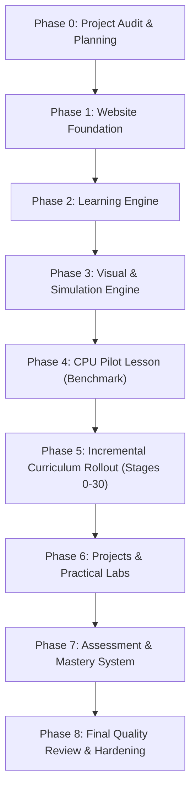

# AI, Systems & Cybersecurity Academy — Master Project Plan

## 1. Executive Summary & Vision

The **AI, Systems & Cybersecurity Interactive Learning Academy** is a university-grade, browser-accessible, interactive engineering platform designed to take a learner from absolute computing fundamentals to advanced engineering and research-level proficiency across:
- **Computer Science & Systems Engineering**
- **Machine Learning & Deep Learning**
- **Language Models & AI Application Engineering**
- **Reliable AI Systems & Performance Engineering**
- **Cybersecurity & Applied Defense**
- **Adversarial AI Security & AI for Cybersecurity**
- **Advanced Research & System Integration**

This platform rejects shallow summaries and static text-dump tutorials. It provides an engineering laboratory where every foundational concept is explained from first principles, visually animated, interactively simulated, coded from scratch, tested, and systematically evaluated.

---

## 2. Technology Stack Architecture

### 2.1 Frontend Platform
- **Core Framework:** React 18+ with TypeScript (Strict mode enabled)
- **Bundler & Dev Server:** Vite (fast HMR, optimized production builds)
- **Routing:** React Router v6 (nested routes for Stages, Lessons, Labs, Simulators, Projects, and Assessments)
- **Styling:** Tailwind CSS (custom dark-mode-first engineering design system)
- **Icons:** Lucide React

### 2.2 Educational Content Engine
- **Content Format:** Modular TypeScript/JSON metadata with embedded MDX/Markdown rendering
- **Math Typesetting:** KaTeX (fast, client-side LaTeX formula rendering)
- **Code Highlighting & Editor:** Monaco Editor for rich code exploration; PrismJS / Highlight.js for lightweight inline snippets
- **Interactive Code Execution:** In-browser Python runtime via Pyodide and WebAssembly / JavaScript simulated environments for safe, zero-backend execution of basic code exercises

### 2.3 Visual Teaching & Simulation Engine
- **Vector & Architecture Diagrams:** Hand-crafted SVG with interactive tooltips and component inspectability
- **Structural Diagrams:** Mermaid.js with custom styling
- **Animated Dataflows & Cycles:** Custom React canvas hooks + GSAP for micro-animations and timing-accurate hardware cycles
- **Mathematical & Data Plots:** Plotly.js / D3.js for interactive loss surfaces, distributions, and vectors
- **3D Visualizations:** Three.js / React Three Fiber for high-dimensional embedding spaces, spatial tensors, and hardware topologies where 3D enhances pedagogical clarity

### 2.4 Backend (Phase-Activated when needed)
- **API Framework:** Python FastAPI
- **Data Persistence:** SQLite (initial lightweight local store), designed with clean repository interfaces to migrate to PostgreSQL
- **Data Models:** Pydantic v2 schemas for curriculum tracking, user notes, experiment telemetry, and assessment logs

---

## 3. Core Platform Features & Page Map

The platform consists of 15 dedicated modules:

1. **Dashboard (`/dashboard`):** Unified overview of student progress, recent stages, active projects, study stats, and dependency-guided "What to learn next".
2. **Curriculum Master Navigator (`/curriculum`):** Interactive visual dependency map and directory of all 31 stages (Part I to Part VIII).
3. **Stage Overview (`/stage/:stageId`):** Deep breakdown of a stage: roadmap subtopics, prerequisites, scratch build requirements, project brief, and mastery check criteria.
4. **Subject Hub (`/subject/:subjectId`):** Domain-specific grouping (e.g. Systems, Deep Learning, Cybersecurity).
5. **Interactive Lesson Engine (`/stage/:stageId/lesson/:lessonId`):** The primary learning interface implementing the 18-point first-principles lesson standard, embedded visualizers, code snippets, step-by-step traces, and review checks.
6. **Visual Learning Laboratory (`/visual-lab`):** Dedicated catalog of all system architecture diagrams, memory maps, network topologies, and mathematical visualizers.
7. **Interactive Simulation Laboratory (`/simulators`):** Standalone sandbox directory containing interactive simulators (CPU instruction cycle, cache simulator, logic gates, neural forward/backward passes, attention matrix explorer, packet sniffer simulator, cipher visualizer).
8. **Programming Playground (`/playground`):** Integrated browser coding space with scratchpad, test runners, and instant feedback.
9. **Exercises & Challenges (`/exercises`):** Graded exercises spanning beginner, intermediate, and advanced levels for every topic.
10. **Engineering Projects Portfolio (`/projects`):** Step-by-step guides for the 25+ "Build from scratch" components and milestone projects.
11. **Assessment & Mastery Verification (`/assessments`):** Deep mastery exams requiring conceptual explanations, implementation debugging, and transfer problem solving.
12. **Learning Progress & Metrics (`/progress`):** Fine-grained tracking of topics, code runs, quiz results, and stage mastery verifications.
13. **Notes, Bookmarks & Knowledge Vault (`/notes`):** Personal engineering journal, code bookmarks, and searchable annotations.
14. **Omni-Search (`/search`):** Instant search across concepts, algorithms, code implementations, hardware terms, and stage materials.
15. **System Settings (`/settings`):** Theme controls, animation speed defaults, simulator rendering preferences, and data export/import.

---

## 4. Phased Development Roadmap

### Phase 0: Project Audit and Planning (CURRENT)
- **Objective:** Audit original PDF roadmap (`AI-Systems-and-Cybersecurity-Master-Roadmap.pdf`), establish zero-gap curriculum inventory, configure project standards, and establish architectural contracts.
- **Deliverables:**
  - `PROJECT_PLAN.md`
  - `CURRICULUM_MASTER.md`
  - `AGENT_RULES.md`
  - `CONTENT_STANDARDS.md`
  - `VISUAL_STANDARDS.md`
  - `PROGRESS_TRACKER.md`
- **Exit Criteria:** Complete extraction of 31 stages, 100% topic alignment with source PDF, signed-off architectural foundation.

### Phase 1: Website Foundation
- **Objective:** Initialize modern Vite + React + TypeScript + Tailwind CSS application structure with responsive navigation, theme system, routes, and baseline state management.
- **Key Modules:**
  - App shell with responsive sidebar, header, breadcrumbs, search shortcut.
  - Dashboard layout, curriculum catalog view, stage breakdown layout, lesson viewer shell.
  - Progress state store with local persistence.
- **Exit Criteria:** Application builds with zero TypeScript/lint errors; responsive UI verified across desktop and mobile viewports.

### Phase 2: Learning Engine
- **Objective:** Build reusable content delivery systems for rich technical instruction.
- **Key Modules:**
  - Lesson renderer supporting LaTeX formulas (`KaTeX`), syntax-highlighted code blocks, copy-to-clipboard, callout boxes (Note, Caution, Deep Dive, Hardware View).
  - Dynamic Table of Contents (sticky, auto-scrolling with reading progress indicator).
  - Code sandbox runner integration.
  - Interactive terminology hover tooltips and prerequisite cross-linking.
- **Exit Criteria:** Fully modular lesson template capable of rendering the 18-point lesson structure cleanly without code duplication.

### Phase 3: Visual & Simulation Engine
- **Objective:** Develop reusable architecture diagram and animation primitives.
- **Key Modules:**
  - SVG diagram container with zoom, pan, hover inspection, and component labeling.
  - Step-by-step animation controller with: **Play, Pause, Reset, Step Forward, Step Backward, Speed Control (0.5x, 1x, 2x)**.
  - Interactive simulator harness with parameter controls, live metrics display, and state inspector.
- **Exit Criteria:** Standardized simulator base components thoroughly tested and ready for domain-specific visualizers.

### Phase 4: CPU Architecture Pilot Lesson (Stage 0 Quality Benchmark)
- **Objective:** Build the flagship benchmark lesson: **Stage 0 → CPU Architecture & Instruction Execution**.
- **Scope (28 Mandatory Topics):**
  1. Why computers need a CPU
  2. What a CPU actually does
  3. CPU history and evolution
  4. CPU architecture overview
  5. Arithmetic Logic Unit (ALU)
  6. Control Unit (CU)
  7. Registers (General-purpose, PC, IR, SP, Flags)
  8. Cache memory (L1, L2, L3, cache lines)
  9. Clock, clock cycles, and frequency
  10. Machine instructions and encoding
  11. Instruction Set Architecture (ISA) concepts
  12. Fetch phase
  13. Decode phase
  14. Execute phase
  15. Memory access phase
  16. Writeback phase
  17. RISC vs. CISC philosophies
  18. x86-64 vs. ARM architectures
  19. Instruction pipelines
  20. Pipeline hazards (Structural, Data, Control)
  21. Branch prediction
  22. Superscalar execution
  23. Out-of-order execution (OoO)
  24. CPU cores, hardware threads, and hyperthreading
  25. IPC (Instructions Per Cycle) and performance equations
  26. CPU benchmarking principles
  27. Practical Linux CPU investigation (`/proc/cpuinfo`, `lscpu`, `perf`, `top`)
  28. Building a simple educational CPU simulator in Python / TypeScript
- **Interactive Visuals & Simulators Included:**
  - CPU block architecture diagram with inspectable bus/registers.
  - Animated Fetch-Decode-Execute-Memory-Writeback 5-stage cycle.
  - Live Register & Flag visualizer.
  - Interactive ALU operation simulator (AND, OR, ADD, SUB, Zero/Overflow flags).
  - Micro-code Instruction Execution Simulator with memory grid.
  - Cache Hit vs. Miss demonstration with latency comparison.
  - 5-stage pipeline hazard & bubble step-by-step visualizer.
  - Educational 8-bit/16-bit CPU simulator capable of running simple programs.
- **Exit Criteria:** Review of educational depth, mechanical accuracy, animation performance, and UI responsiveness. Acts as the blueprint for all subsequent lessons.

### Phase 5: Incremental Curriculum Content Rollout
- **Objective:** Implement lessons stage by stage according to dependency order (Stages 0 through 30).
- **Execution Rules:** One lesson at a time. No placeholder content. Adherence to the 18-point first principles structure.

### Phase 6: Practical Labs & Projects Portfolio
- **Objective:** Complete the end-to-end interactive project environments and scratch implementations (25+ required portfolio items).

### Phase 7: Assessment & Mastery Verification System
- **Objective:** Deploy quizzes, interactive diagnostic checks, coding verification tests, and capstone evaluation matrices.

### Phase 8: Final Quality Review & Hardening
- **Objective:** Comprehensive testing of all simulators, link integrity, cross-browser compatibility, responsive layout fidelity, and performance benchmarks.

---

## 5. Verification & Testing Strategy

Every stage and lesson must undergo three tiers of validation before sign-off:
1. **Technical Accuracy Verification:** Primary documentation checks (e.g. Intel/ARM manuals, RFCs, NIST guidelines, PyTorch/Linux source documentation).
2. **Interactive Component Testing:** Automated unit testing of simulator logic (state transitions, instruction decoding, register mutations) and UI render tests.
3. **Pedagogical Evaluation:** Verification that the lesson answers all 18 core first-principles questions and includes beginner-to-advanced progression.
